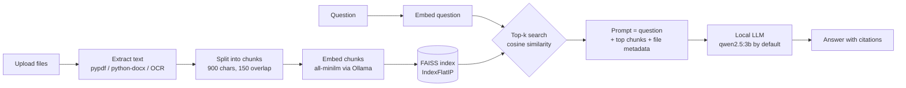

# Lumina RAG

A private, local-first document assistant. Upload PDFs, Word files or text, ask questions in plain English, and get answers with clickable citations. Everything runs on your own machine: local LLMs through Ollama, vector search through FAISS, and a FastAPI backend. No API keys, no cloud calls, no token cost.


---

## Contents

1. [What it does](#what-it-does)
2. [How it works](#how-it-works)
3. [Quick start](#quick-start)
4. [Using the app](#using-the-app)
5. [Configuration](#configuration)
6. [API](#api)
7. [Evaluation](#evaluation)
8. [Tests](#tests)
9. [Project structure](#project-structure)
10. [Design decisions and trade-offs](#design-decisions-and-trade-offs)
11. [What went wrong and what I learned](#what-went-wrong-and-what-i-learned)
12. [Limitations and roadmap](#limitations-and-roadmap)

---

## What it does

| Feature | Detail |
| --- | --- |
| Document Q&A with citations | Answers cite the exact chunks they came from; click a citation to see the source text |
| Fully local | LLM and embeddings run in Ollama on your machine; documents never leave it |
| Switch models at runtime | Pick any installed Ollama chat model (qwen2.5, phi4-mini, deepseek-r1, ...) from the UI without restarting |
| Many file types | PDF, DOCX, TXT, MD, CSV, JSON, HTML |
| OCR for scanned PDFs | Native text extraction first; optional GPU OCR (Unlimited-OCR) when a PDF has no text layer |
| Metadata questions | "Which file did I upload last?" works because file metadata is added to the prompt |
| Live ingestion progress | Server-Sent Events stream indexing progress to the UI |
| OpenAI-compatible endpoint | `/v1/chat/completions` lets other chat UIs use Lumina as a backend |
| Library management | Search, delete to trash, restore, session history, feedback and memory |

---

## How it works



**Step by step**

1. **Extract.** PDFs are read page by page with `pypdf` so citations can point to a page. Scanned PDFs can go through OCR.
2. **Chunk.** Text is split on paragraph, line, sentence and word boundaries into chunks of at most 900 characters. Each chunk starts with the last 150 characters of the previous one so an answer is not cut in half at a boundary.
3. **Embed.** Each chunk becomes a 384-dimensional vector using the `all-minilm` model in Ollama. Vectors are L2-normalised.
4. **Index.** Vectors go into a FAISS `IndexFlatIP` (exact inner-product search). On normalised vectors inner product equals cosine similarity.
5. **Retrieve.** The question is embedded the same way and the top 3 chunks are returned. Chunks scoring below 0.35 are dropped so weak matches do not reach the LLM.
6. **Generate.** The prompt contains the question, the retrieved chunks with their IDs, and a summary of the library's files. The LLM (temperature 0.2) is told to cite chunk IDs.

---

## Quick start

### Prerequisites

| Tool | Version | Check |
| --- | --- | --- |
| Python | 3.11 or newer | `python --version` |
| Ollama | latest | `ollama --version` ([download](https://ollama.com/download)) |
| Git | any | `git --version` |

About 4 GB of free disk space is needed for the default models.

### Option A: one command (recommended)

The start script creates a virtual environment, installs dependencies, pulls the models (`qwen2.5:3b` and `all-minilm`) and starts the server.

```bash
git clone https://github.com/jeevanraj-28/lumina-rag-assistant.git
cd lumina-rag-assistant

# Windows (PowerShell)
.\start.ps1

# macOS / Linux / WSL
chmod +x start.sh
./start.sh
```

Open **http://localhost:8000**.

### Option B: manual setup

```bash
git clone https://github.com/jeevanraj-28/lumina-rag-assistant.git
cd lumina-rag-assistant

python -m venv .venv
# Windows: .venv\Scripts\activate
source .venv/bin/activate

pip install -r requirements.txt
cp .env.example .env            # Windows: copy .env.example .env

ollama pull qwen2.5:3b          # chat model
ollama pull all-minilm          # embedding model

uvicorn app.main:app --reload --port 8000
```

### Option C: Docker

The image installs Ollama inside the container and pulls both models on first start (the first start takes a few minutes).

```bash
docker build -t lumina-rag .
docker run -d -p 8000:8000 -v lumina-data:/app/data --name lumina-rag lumina-rag
```

The `-v lumina-data:/app/data` volume keeps your documents, index and downloaded models between restarts.

### Troubleshooting

| Problem | Fix |
| --- | --- |
| `Embedding model all-minilm is unavailable` | Ollama is not running or the model is missing: run `ollama serve`, then `ollama pull all-minilm` |
| `No indexed documents` when asking | Upload files, then click Ingest (or `POST /ingest`) before asking |
| Answers are slow | The first answer loads the model into memory. Try a smaller model, or lower `RAG_TOP_K` |
| Port 8000 is busy | Set `APP_PORT=8001` in `.env`, or `uvicorn app.main:app --port 8001` |

---

## Using the app

1. Open http://localhost:8000.
2. Drag files into the upload area (or put them in `data/inbox/`).
3. Click **Ingest**. A progress bar shows extraction, chunking and indexing.
4. Ask a question. Click a citation such as `[Evidence 3f2a…]` to see the source text.
5. Switch the model from the dropdown in the header at any time.

Try it with the sample documents in [`eval/sample_docs`](eval/sample_docs): fictional bank policies on personal loans, trade finance and KYC. For example: *"What is the foreclosure charge in the second year?"*

---

## Configuration

All settings are environment variables, read from `.env`.

| Variable | Default | What it controls |
| --- | --- | --- |
| `OLLAMA_BASE_URL` | `http://127.0.0.1:11434` | Where Ollama is running |
| `OLLAMA_MODEL` | `qwen2.5:3b` | Default chat model |
| `OLLAMA_EMBEDDING_MODEL` | `all-minilm` | Embedding model (changing it requires re-ingesting) |
| `RAG_DATA_DIR` | `data` | Where uploads, the index and app state are stored |
| `RAG_TOP_K` | `3` | Chunks retrieved per question |
| `RAG_CHUNK_SIZE` | `900` | Maximum chunk length, in **characters** |
| `RAG_CHUNK_OVERLAP` | `150` | Characters repeated from the previous chunk |
| `RAG_MIN_RELEVANCE_SCORE` | `0.35` | Cosine score below which a chunk is ignored |
| `RAG_MAX_FILE_MB` | `25` | Maximum upload size per file |
| `RAG_OCR_MODE` | `native` | `native`, `auto` (OCR only when a PDF has little text) or `unlimited` (always OCR) |

---

## API

Interactive docs are at **http://localhost:8000/docs** once the server is running.

| Endpoint | Method | Purpose |
| --- | --- | --- |
| `/health` | GET | Server status, chunk count, active model |
| `/upload` | POST | Upload one or more files |
| `/ingest` | POST | Extract, chunk, embed and index uploaded files (runs as a background job) |
| `/ingest/{job_id}` | GET | Status of an ingestion job |
| `/events` | GET | Server-Sent Events stream of ingestion progress |
| `/ask` | POST | Ask a question, get an answer plus sources |
| `/sources/{citation_id}` | GET | Full text of a cited chunk |
| `/search` | GET | Search the library |
| `/models`, `/models/active` | GET, PUT | List chat models, switch the active one |
| `/files`, `/files/delete`, `/files/trash/*` | GET, POST | Manage the library and trash |
| `/v1/models`, `/v1/chat/completions` | GET, POST | OpenAI-compatible API |

Example:

```bash
curl -X POST http://localhost:8000/ask \
  -H "Content-Type: application/json" \
  -d '{"question": "What documents are needed for a personal loan?", "top_k": 3}'
```

---

## Evaluation

Answers that look right are not evidence. [`eval/retrieval_eval.py`](eval/retrieval_eval.py) measures retrieval on a labelled question set, using the app's own chunker and the same cosine search as the app.

**Data.** 3 fictional bank documents in [`eval/sample_docs`](eval/sample_docs) and 20 questions in [`eval/questions.jsonl`](eval/questions.jsonl). Each question is worded differently from the document (for example "inactive" vs "dormant") and records the exact phrase that answers it.

**Metrics.**
- **recall@k**: share of questions where a top-k chunk from the right file contains the answer phrase.
- **MRR** (mean reciprocal rank): 1 if the right chunk is first, 0.5 if second, and so on, averaged.

**Run it.**

```bash
# Semantic search, exactly as the app does it (needs Ollama + all-minilm)
python eval/retrieval_eval.py --embedder ollama

# Keyword (TF-IDF) baseline, needs only numpy
python eval/retrieval_eval.py --embedder tfidf

# Your own documents and questions
python eval/retrieval_eval.py --docs my_docs/ --questions my_questions.jsonl
```

Each run writes a Markdown table to `eval/results_<embedder>.md` and the questions it missed to `eval/results_<embedder>.misses.json` for error analysis.

**Keyword baseline** (TF-IDF, from [`eval/results_tfidf.md`](eval/results_tfidf.md)):

| Chunk size | Overlap | recall@1 | recall@3 | recall@5 | MRR |
| --- | --- | --- | --- | --- | --- |
| 300 | 0 | 0.40 | 0.70 | 0.80 | 0.556 |
| 300 | 150 | 0.50 | 0.75 | 0.90 | 0.643 |
| 600 | 0 | 0.50 | 0.80 | 0.85 | 0.635 |
| 600 | 150 | 0.55 | 0.75 | 0.80 | 0.660 |
| 900 | 0 | 0.45 | 0.80 | 0.85 | 0.629 |
| 900 | 150 | 0.60 | 0.85 | 0.85 | 0.717 |

Keyword search misses paraphrased questions, such as "inactive" for "dormant", or "payee I added a few minutes ago" for "newly added beneficiary". Embeddings exist to fix exactly these. Run the `ollama` evaluation to see how much they help on the same questions.

**Caveat.** 20 questions is a small set: one question is 5 percentage points. Treat differences under about 10 points as noise.

---

## Tests

```bash
python -m unittest discover -s tests -v
```

[`tests/test_chunking.py`](tests/test_chunking.py) checks that no text is lost during chunking, that chunks respect the size limit and that the overlap is carried forward. The tests need no Ollama, FAISS or FastAPI.

---

## Project structure

```
lumina-rag-assistant/
├── app/
│   ├── main.py              # FastAPI app: ingestion, chunking, retrieval, generation, library APIs
│   ├── unlimited_ocr.py     # Adapter for the optional GPU OCR model
│   └── static/              # Web UI (HTML, CSS, JS, fonts, served offline)
├── eval/
│   ├── retrieval_eval.py    # Retrieval evaluation harness (recall@k, MRR)
│   ├── questions.jsonl      # 20 labelled questions
│   ├── sample_docs/         # 3 fictional bank documents
│   └── results_tfidf.md     # Keyword baseline results
├── tests/
│   └── test_chunking.py     # Chunker tests
├── data/                    # Runtime data: inbox, library, index (git-ignored)
├── Dockerfile               # Image with Ollama + app
├── docker-entrypoint.sh     # Starts Ollama, pulls models, starts the API
├── start.sh / start.ps1     # One-command local start
├── requirements.txt         # Core dependencies
├── requirements-ocr.txt     # Optional OCR dependencies (GPU)
└── .env.example             # Configuration template
```

---

## Design decisions and trade-offs

| Decision | Why | Trade-off |
| --- | --- | --- |
| Local models through Ollama | Privacy, zero cost, works offline | A 3B model reasons less well and hallucinates more than large hosted models |
| `all-minilm` embeddings | Small (about 45 MB) and fast on a CPU | Weaker on domain language than larger embedding models; reads roughly 256 tokens per chunk |
| FAISS `IndexFlatIP` (exact search) | Exact results; fast enough for thousands of chunks | Search time grows linearly; at millions of chunks switch to IVF or HNSW |
| Characters, not tokens, for chunk size | No tokenizer dependency | Chunk length in tokens varies with language |
| Score threshold 0.35 | Keeps weak matches out of the prompt, which reduces made-up answers | Too high a threshold returns "not found" for valid questions |
| No framework (LangChain etc.) | Every step is visible and debuggable in one file | More code to maintain |

---

## What went wrong and what I learned

**The chunker silently dropped about 13% of every document.** The original `split_text` built chunks of up to 900 characters, then added the 150-character overlap in front and cut the result back to 900 characters. The cut removed the end of each chunk, and that text was in no other chunk either, so it was never indexed. On a 3,000-word test document, 399 words never reached the index.

Nothing looked broken: answers were fluent and most questions still worked. It only showed up when I wrote a test that checks every word of a document lands in some chunk. The fix reserves room for the overlap before splitting. [`tests/test_chunking.py`](tests/test_chunking.py) fails on the old code and passes on the new one.

The lesson: in a RAG system, retrieval can fail without any visible error. Test the pipeline step by step with measurable checks, rather than judging it by how good the answers look.

---

## Limitations and roadmap

**Current limitations**

- Dense search alone is weak on exact strings such as account numbers or clause IDs.
- No reranking: the top 3 chunks by embedding similarity go straight to the LLM.
- Answer quality (correctness, faithfulness to sources) is not yet measured automatically, only retrieval.
- OCR output for multi-page scans has no page numbers, so citations point to the file only.

**Next steps**

- [ ] Hybrid search: BM25 + embeddings, merged with reciprocal rank fusion
- [ ] Cross-encoder reranker on the top 20 chunks
- [ ] Answer-level evaluation: correctness and "is every claim supported by a cited chunk"
- [ ] pgvector backend option for multi-user deployments

---

## Author

**Jeevan Raj M** · [LinkedIn](https://linkedin.com/in/jeevan-raj-m-5ba64a383) · [GitHub](https://github.com/jeevanraj-28) · [Portfolio](https://jeevanraj-28.github.io)

Licensed under the [MIT License](LICENSE).
